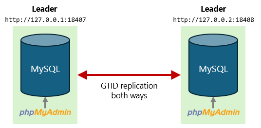
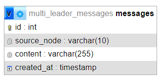

# Leader-Leader Replication Demo
Two MySQL-based database server with their respective phpMyAdmin installation.

## Topology



The two phpMyAdmin instances are independent browser clients. Each is permanently
connected to its MySQL server.

Both MySQL nodes are writable. Each is simultaneously a source and a replica.

## Entity-Relationship Diagram



The table `messages` contains text messages that can be written by both servers.

## Containers

- `node_a`: MySQL 8.4 database server and phpMyAdmin 5.2.3 for Node A
- `node_b`: MySQL 8.4 database server and phpMyAdmin 5.2.3 for Node B

## Usage

1. Run `docker compose up -d`
2. In a browser tab, open Node A: `http://127.0.0.1:18407`
3. In another browser tab, open Node B: `http://127.0.0.2:18408`
4. Log in in both with:

    ```text
    Username: root
    Password: root
    ```
    Database `multi_leader_messages`.
5. In Node A, run the queries in `queries/01-node_a.sql`. In the follower, run the queries in `queries/02-node-b.sql`. Specifically run an `INSERT` in one of the nodes and immediately find the new row in the other node. Try it both ways

## Reset

```bash
docker compose down -v
docker compose up -d
```

## Collision Avoidance

Both nodes use GTID mode.

Node A uses `auto_increment_increment = 2` and `auto_increment_offset = 1`, so it generates odd ids: `1, 3, 5, ...`.

Node B uses `auto_increment_increment = 2` and `auto_increment_offset = 2`, so it generates even ids: `2, 4, 6, ...`.

This avoids the simplest primary-key collision when both nodes insert independently.

### Important Limitation

This setup avoids `AUTO_INCREMENT` collisions, but it does not make arbitrary concurrent conflicting writes safe. Two nodes can still update the same existing row at nearly the same time. Classic asynchronous MySQL leader-leader replication does not provide distributed conflict resolution or synchronous consensus.

This demo illustrates bidirectional replication, not a conflict-free multi-primary database system.

## Tools
MySQL 8.4

## Author
ChatGPT 5.6-Sol, prompted by Arturo Mora-Rioja